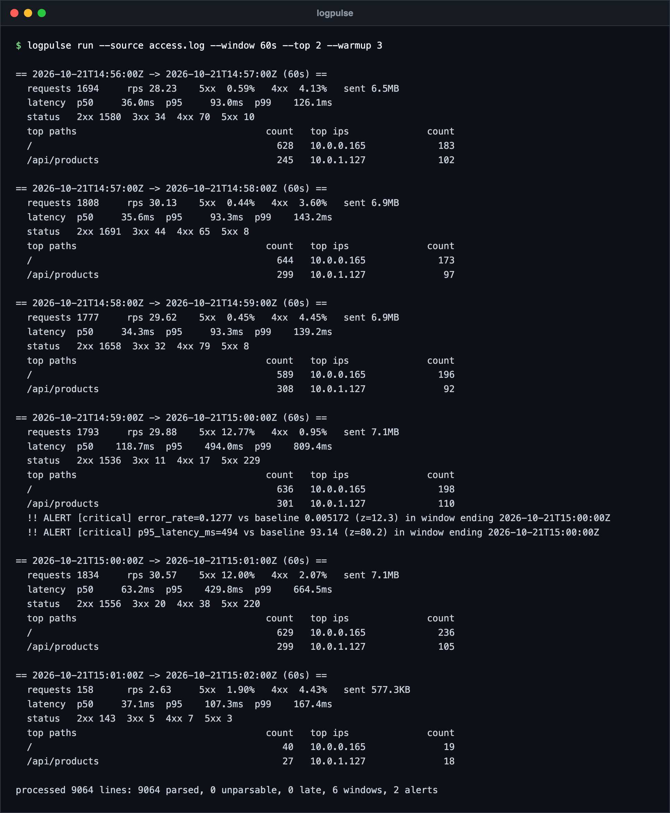
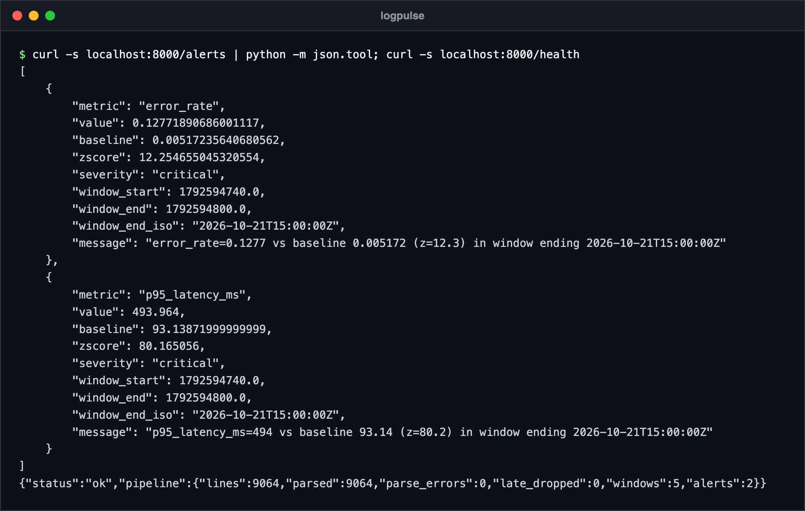
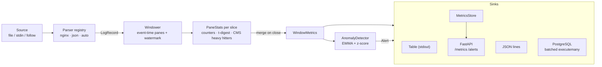

# logpulse


Streaming log analytics in a single Python process. `logpulse` reads nginx or JSON access
logs from a file or stdin (optionally following the file like `tail -F`), aggregates them into
tumbling or sliding event-time windows, and reports request rate, status-code mix, latency
percentiles, top paths and top client IPs. An EWMA + z-score detector watches error rate and
latency and raises alerts when they jump. Results go to the console, JSON lines, PostgreSQL,
or a small HTTP API.

## Screenshots

A synthetic access log (from `scripts/generate_logs.py`, 30 requests per second with an incident injected at 200 s) read through 60 second tumbling windows. The window that contains the incident raises two alerts, one for error rate and one for p95 latency. `--warmup 3` lets the detector start scoring after three windows, because this log is only five minutes long. The data is generated, not production traffic.



The same pipeline with `--serve`: the alerts and the pipeline counters over HTTP.



## Why

Most teams already ship logs somewhere, but the questions asked during an incident are always
the same: *how many requests, how many errors, how slow, which endpoint, which client?*
Answering them exactly needs every latency and every key in memory. `logpulse` answers them in
**bounded memory per window** with mergeable sketches, which is the same approach used inside
large observability systems, kept small enough to read in one sitting. The core has no
runtime dependencies; FastAPI and psycopg are optional extras.

## Architecture



1. A **source** yields lines. In follow mode it also yields idle heartbeats, so windows close
   by wall clock even when the log goes quiet, and it reopens the file after rotation or
   truncation.
2. A **parser** turns a line into a normalised `LogRecord` or returns `None` (counted, never
   fatal). Parsers are registered by name with `@register_parser("name")`.
3. The **windower** cuts event time into panes of `slide` seconds. A window is
   `size / slide` consecutive panes; tumbling windows are the case `slide == size`.
4. When the **watermark** (max event time seen minus allowed lateness) passes a window's end,
   its panes are merged into `WindowMetrics`, scored by the **detector**, and fanned out to
   every **sink**.

## Algorithms

| Concern | Algorithm | Update | Query | Memory |
| --- | --- | --- | --- | --- |
| p50 / p95 / p99 latency | Merging t-digest, k1 scale function | amortised O(log δ) | O(δ) | O(δ) centroids (δ = compression, default 100) |
| Top-N paths and IPs | Count-Min Sketch + min-heap candidate set | O(d + log k) | O(k log k) | O(w·d + k) |
| Error-rate / latency anomalies | EWMA mean and variance, z-score | O(1) | O(1) | O(1) per metric |
| Sliding windows | Pane merging (each record is processed once) | O(1) per record | O(panes) merges per window | O(size / slide) panes |

**t-digest.** Points are buffered and merged into a sorted centroid list in one pass. Two
neighbours are combined only while the scale function
`k(q) = δ / 2π · asin(2q − 1)` grows by at most 1 across the result, so centroids are tiny at
the tails and large near the median. That is why tail percentiles stay accurate: on 50,000
log-normal latencies the test suite asserts p50, p95 and p99 within 2% relative error, using
fewer than 200 centroids for 200,000 points. Digests merge by re-compressing the union of
their centroids.

**Count-Min Sketch.** `d = ⌈ln(1/δ)⌉` rows of `w = ⌈e/ε⌉` counters. Estimates never
undercount and overcount by at most `ε·N` with probability `1 − δ`. Row indexes come from one
keyed BLAKE2b digest split into two 64-bit hashes (double hashing). A candidate set of at most
`k` items, ordered by a lazily invalidated min-heap, turns the sketch into a heavy-hitters
tracker. Sketches with the same shape and seed merge by adding tables, which is what makes
sliding windows cheap.

**EWMA + z-score.** For each metric:
`mean += α·(x − mean)` and `var = (1 − α)·(var + α·(x − mean)²)`. A window is scored against
the baseline *before* it is folded in. A per-metric `min_std` floor (1 percentage point for
error rate, 5 ms for latency) prevents a flat history from turning the first error into an
infinite z-score. Severity is `critical` at twice the threshold.

## Quick start

```bash
python -m venv .venv && source .venv/bin/activate
pip install -e ".[api,postgres]"        # or just `pip install -e .` for the core

python scripts/generate_logs.py --duration 600 --rate 50 --incident-at 360 > access.log
logpulse run --source access.log --window 60s
```

With Docker:

```bash
docker build -t logpulse .
python scripts/generate_logs.py --duration 600 | docker run --rm -i logpulse
```

## CLI examples

```bash
# Tumbling one-minute windows over a file (format is auto-detected per line)
logpulse run --source /var/log/nginx/access.log --window 60s

# Five-minute windows that slide every 30 s, tolerating 10 s of out-of-order lines
logpulse run --source access.log --window 5m --slide 30s --lateness 10s

# Follow a live JSON application log from its current end
logpulse run --source app.log --format json --follow --from-end

# Pipe from anything; write JSON lines to a file and still print the table
kubectl logs -f deploy/web | logpulse run --sink table --sink jsonl:metrics.jsonl

# Persist windows and alerts to PostgreSQL (tables are created if missing)
logpulse run --source access.log --sink postgres --pg-dsn postgresql://localhost/logs

# Serve current metrics over HTTP while processing
logpulse run --source access.log --follow --serve --port 8000
curl localhost:8000/metrics            # latest closed window
curl "localhost:8000/metrics/history?limit=10"
curl localhost:8000/alerts
curl localhost:8000/health             # pipeline counters

# Tune the detector
logpulse run --source access.log --alpha 0.2 --z-threshold 4 --warmup 10 --min-requests 50
```

Supported inputs:

- **nginx / Apache combined** format, optionally followed by `$request_time` in seconds:
  `log_format pulse '$remote_addr - $remote_user [$time_local] "$request" $status $body_bytes_sent "$http_referer" "$http_user_agent" $request_time';`
- **JSON lines** with common aliases: `timestamp|time|ts|@timestamp` (ISO-8601 or epoch
  s/ms), `status|status_code`, `path|url|uri`, `ip|remote_addr|client_ip`, and latency from
  `latency_ms|duration_ms` (ms) or `request_time|duration` (s).

## Design decisions

- **Event time, not arrival time.** Windows follow the timestamps in the log, so replaying
  yesterday's file gives the same numbers as watching it live. A watermark with configurable
  lateness handles mildly out-of-order lines; anything older is dropped and counted.
- **Panes instead of per-window state.** A sliding window is a merge of panes, so a record is
  touched once no matter how many windows overlap it. This is why every sketch here is
  mergeable, and why the latency sketch is a t-digest rather than P², which cannot be merged.
- **Empty windows are skipped.** A gap of an hour in a log does not produce sixty empty rows;
  a gap in output means no traffic.
- **Anomalies still update the baseline.** A lasting level shift (a new release that is
  permanently 20 ms slower) alerts on the first windows and then becomes the new normal,
  instead of paging forever. Small windows (`--min-requests`) are not scored at all.
- **Idempotent PostgreSQL writes.** Windows are unique on `(source, window_start,
  window_end)` and inserted with `ON CONFLICT DO NOTHING`, so re-running a file is safe. Rows
  are buffered and written with one `executemany` per table per batch.
- **No framework in the core.** The pipeline is plain Python with no dependencies; FastAPI,
  uvicorn and psycopg are optional extras imported only when used.
- **Deliberately left out:** distributed ingestion, persistence of sketch state across
  restarts, and per-path latency breakdowns. Each is a natural extension of the pane model,
  not a rewrite.

## Running tests

```bash
pip install -e ".[dev,api]"
ruff check . && ruff format --check .
pytest
```

The suite covers quantile accuracy against exact values, Count-Min error bounds and merge
equivalence, window boundaries, sliding overlaps, lateness and late drops, anomaly triggers
and suppression, the parsers, follow mode across log rotation, the sinks (PostgreSQL through
a fake connection), the HTTP API, and an end-to-end run where an incident injected by the
generator must raise both alerts.

## Project layout

```text
src/logpulse/
  sketches/tdigest.py    streaming quantiles
  sketches/countmin.py   Count-Min Sketch and heavy hitters
  parsers.py             nginx, JSON and auto parsers + registry
  sources.py             file, stdin and follow mode
  windows.py             panes, tumbling and sliding windows, watermark
  anomaly.py             EWMA + z-score detector
  sinks.py               table, JSON lines, PostgreSQL
  store.py, api.py       in-memory store and FastAPI app
  pipeline.py, cli.py    wiring and command line
scripts/generate_logs.py sample traffic with optional incidents
```

## License

MIT, see [LICENSE](LICENSE). Author: Ahmed Mahdy.
